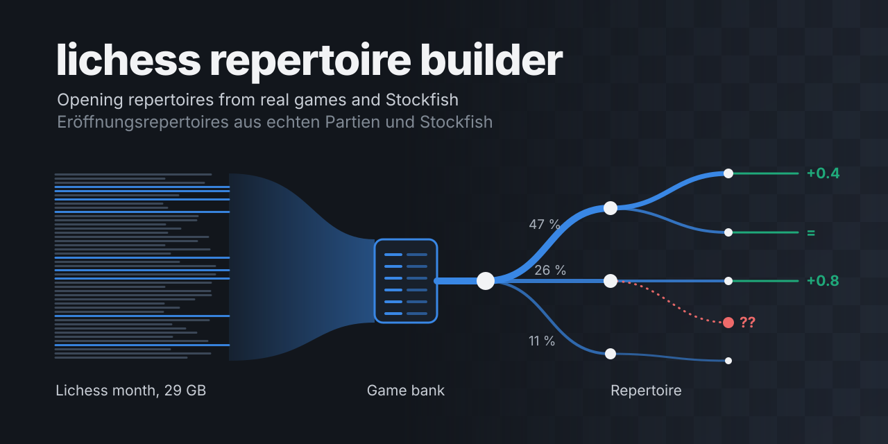

# lichess repertoire builder

[English](README.md) | **Deutsch**

Du sagst, welche Eröffnung du spielst. Das Werkzeug nimmt echte Lichess Partien aus deinem Elo Bereich und baut daraus ein Repertoire als PGN: was deine Gegner wirklich spielen, wo sie am häufigsten Fehler machen und wie Stockfish die Stellungen sieht. Die PGN öffnest du in einer Lichess Studie oder in ChessBase.

[Schnellstart](#schnellstart-mac) · [Die Idee](#die-idee-dahinter) · [So arbeitest du damit](#so-arbeitest-du-am-besten-damit) · [Optionen](#optionen) · [Gut zu wissen](#gut-zu-wissen)

## Schnellstart (Mac)

**1. Programme installieren** (einmalig, im Programm Terminal). Falls Homebrew fehlt, zuerst die Zeile von [brew.sh](https://brew.sh) ausführen.

```bash
brew install python zstd pv mawk stockfish
```

**2. Werkzeug herunterladen**

```bash
git clone https://github.com/MisterMiles/lichess-repertoire-builder.git
cd lichess-repertoire-builder
```

Ohne git: oben auf GitHub „Code“ und dann „Download ZIP“ wählen, entpacken und im Terminal mit `cd` in den Ordner wechseln.

**3. Repertoire bauen**

```bash
bash repertoire.sh white "1. e4"
```

Beim ersten Lauf richtet das Skript alles Nötige selbst ein. Die Farbe ist `white` oder `black`, Züge schreibst du in englischer Notation. Für Schwarz gehört deine eigene Antwort mit in die Startzüge.

```bash
# Schwarz gegen 1.d4 mit 1...d5, Gegner mit Elo 1600 bis 2000, erst ein schneller Probelauf
bash repertoire.sh black "1. d4 d5" --elo 1600-2000 --quick

# Mehr Partien: die letzten drei Monate statt einem
bash repertoire.sh white "1. e4" --months 3
```

## Was du bekommst

Die Ergebnisse landen im Ordner `repertoires` neben dem Tool Ordner (änderbar mit `--out`).

| Datei | Inhalt |
| --- | --- |
| `NAME.pgn` | Dein Repertoire, ein Kapitel je Linie, sortiert danach, wie oft du sie bekommst. Die Hauptvarianten laufen mindestens bis Zug 15, seltene Linien stehen gebündelt am Ende. |
| `NAME_quickstart.pgn` | Die 15 wahrscheinlichsten Linien bis Zug 14, ideal zum Üben. |
| `NAME_strukturen.json` | Die typischen Bauernstrukturen mit allen Zahlen. |

Am Linienende stehen Stockfish Bewertung, eine Musterpartie und blaue Pfeile für den Aufbau, der in der Praxis am besten gepunktet hat. Am Kapitelende stehen die häufigsten Fehler deiner Gegner samt Widerlegung. Partien, Zwischenspeicher der Engine und `konfiguration.json` bleiben in `repertoires/arbeit/NAME`, der Tool Ordner bleibt sauber.

## Die Idee dahinter

Ein Repertoire aus dem Buch sagt dir, was in der Theorie am besten ist. Dieses Werkzeug sagt dir, was dir auf deinem Niveau wirklich begegnet und wie du darauf reagierst.

- **Erst die Praxis, dann die Engine.** Die Partien bestimmen, was hineinkommt und in welcher Reihenfolge. Stockfish prüft und korrigiert, er wählt nicht die Themen.
- **Stellungen statt Zugfolgen.** Verschiedene Zugfolgen, die zur selben Stellung führen, werden zusammengezählt.
- **Fehler, die wirklich passieren.** Zu jeder Stellung siehst du, welche Fehler deine Gegner tatsächlich machen, wie oft, und was sie bestraft.
- **Pläne, nicht nur Züge.** Jede Linie endet mit einer Musterpartie, dem am besten punktenden Aufbau und der Bauernstruktur, auf die du zusteuerst.
- **Einmal sammeln, oft auswerten.** Der langsame Teil sind die Rohdaten. Sie werden einmal zur Partienbank. Jedes weitere Repertoire durchsucht nur noch die Bank, und die Stockfish Ergebnisse werden zwischengespeichert.

## So arbeitest du am besten damit

1. **Günstig ausprobieren.** Starte zuerst mit `--quick`. Falsche Startzüge fallen auf, bevor etwas heruntergeladen wird.
2. **Der erste volle Lauf baut die Partienbank.** Hänge `--months 3 --bank ORDNER --archive ORDNER --delete-archive` an und lass `--quick` weg. Jede 29 GB Monatsdatei wird gelöscht, sobald ihre Tabelle fertig ist.
3. **In der richtigen Reihenfolge lesen.** Zuerst die Quickstart Datei, dann die Hauptdatei als Nachschlagewerk.
4. **In kleinen Schritten lernen.** Importiere die PGN in eine Lichess Studie und lerne von oben nach unten, die Reihenfolge ist die Reihenfolge der Wichtigkeit.
5. **Anpassen und neu laufen lassen.** Die Einstellungen stehen in `konfiguration.json` im Arbeitsordner. Ein neuer Lauf nutzt Partien und Engine Ergebnisse wieder.
6. **Mit dem eigenen Repertoire vergleichen** über `--repertoire PGN`. Deine Züge werden markiert.
7. **Ab und zu auffrischen.** Neue Monate kommen in dieselbe Bank.

Die Zahlen sind Statistik von Onlinepartien in deinem Elo Bereich, ohne Bullet und Bots. Linien mit wenigen Partien sind unsicher, Bewertungen entstehen bei fester Tiefe, und die Musterpartie ist ein Beispiel, kein Beweis.

## Optionen

| Option | Bedeutung | Standard |
| --- | --- | --- |
| `--elo VON-BIS` | Elo Bereich beider Spieler | 1800-2499 |
| `--month JJJJ-MM` / `--month A..B` | Ein Monat oder ein Bereich | letzter voller Monat |
| `--months N` | Die letzten N vollen Monate | aus |
| `--bank ORDNER` | Partienbank: jeder Monat wird einmal zu einer kompakten Tabelle (etwa 5 GB pro Monat), spätere Analysen brauchen Sekunden pro Monat | aus |
| `--archive ORDNER` | Monatsdateien (je etwa 29 GB) behalten statt nur zu streamen | aus |
| `--delete-archive` / `--keep-archive` | Monatsdateien löschen, sobald die Bank sie hat, oder nie. Ohne beides wirst du einmal am Start gefragt | fragen |
| `--out ORDNER` | Wohin die fertigen Dateien kommen | `repertoires` neben dem Tool |
| `--repertoire PGN` | Dein eigenes Repertoire, seine Züge werden markiert | aus |
| `--quick` | Probelauf mit geringer Stockfish Tiefe | aus |
| `--notation de` | Deutsche Figurenbuchstaben (S, L, T, D) in Namen und Kommentaren | englisch |
| `--plain` | Ohne Animation | Animation an |

Die vollständige Liste mit allen Feineinstellungen steht in der [ausführlichen Anleitung](docs/ANLEITUNG.md).

## Gut zu wissen

- **Dauer:** Ein Lichess Monat wird aus dem Internet gestreamt (etwa 29 GB, nichts davon wird gespeichert). Das dauert 30 Minuten bis einige Stunden, danach rechnet Stockfish 15 bis 60 Minuten. Mit `--quick` siehst du das Ergebnis in wenigen Minuten, sobald die Partien da sind.
- **Nochmal starten:** Mit denselben Angaben nutzt das Skript die schon geladenen Partien und rechnet nur, was fehlt. Ein Monat, der schon in der Bank ist, wird nie neu gebaut.
- **Beim Warten:** Bei jedem Schritt hüpft ein Springer über ein kleines Brett, dazu Prozent und Restzeit.
- **Linux:** Statt Homebrew `sudo apt install python3-venv zstd pv mawk stockfish`, der Rest ist gleich.

## Lizenz

GPL 3.0, siehe [LICENSE](LICENSE). Daten: [Lichess Open Database](https://database.lichess.org), Engine: [Stockfish](https://stockfishchess.org).
