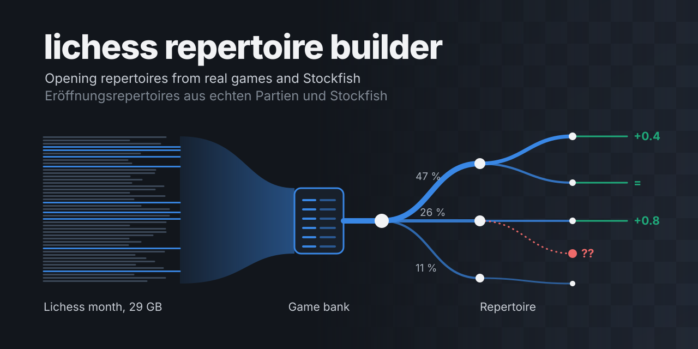

# lichess repertoire builder

[English](README.md) | **Deutsch**

Baut ein Eröffnungsrepertoire aus echten Lichess Partien in deinem Elo Bereich. Du nennst die Eröffnung, du bekommst eine PGN mit:

- den Zügen, die deine Gegner wirklich spielen, ein Kapitel je Linie, sortiert danach, wie oft du sie bekommst
- zu jeder Stellung den häufigsten Fehlern deiner Gegner und was sie widerlegt
- am Ende jeder Linie einer Stockfish Bewertung und einer Musterpartie
- blauen Pfeilen für den Aufbau, der in der Praxis am besten gepunktet hat
- den typischen Bauernstrukturen mit allen Zahlen

Verschiedene Zugfolgen, die in dieselbe Stellung führen, werden zusammengezählt. Die Partien entscheiden, was hineinkommt, Stockfish prüft nur. Die PGN öffnest du in einer Lichess Studie oder in ChessBase.

[Schnellstart](#schnellstart-mac) · [Was du bekommst](#was-du-bekommst) · [Optionen](#optionen) · [Gut zu wissen](#gut-zu-wissen)

## Schnellstart (Mac)

1. Programme einmalig im Programm Terminal installieren. Falls Homebrew fehlt, zuerst die Zeile von [brew.sh](https://brew.sh) ausführen.

```bash
brew install python zstd pv mawk stockfish
```

2. Werkzeug herunterladen. Ohne git: auf GitHub „Code“ und „Download ZIP“ wählen, entpacken und mit `cd` in den Ordner wechseln.

```bash
git clone https://github.com/MisterMiles/lichess-repertoire-builder.git
cd lichess-repertoire-builder
```

3. Repertoire bauen.

```bash
bash repertoire.sh white "1. e4"
```

```bash
# Schwarz gegen 1.d4 mit 1...d5, Gegner mit Elo 1600 bis 2000, erst ein schneller Probelauf
bash repertoire.sh black "1. d4 d5" --elo 1600-2000 --quick
```

Für einen vollen Lauf nimmst du mehr Monate an Partien:

```bash
bash repertoire.sh white "1. e4" --months 3
```

## Was du bekommst

Die Dateien landen im Ordner `repertoires` neben dem Tool Ordner (mit `--out` änderbar).

| Datei | Inhalt |
| --- | --- |
| `NAME.pgn` | Das Repertoire. Die Hauptvarianten laufen mindestens bis Zug 15, seltene Linien stehen gebündelt am Ende. |
| `NAME_quickstart.pgn` | Die 15 wahrscheinlichsten Linien bis Zug 14, zum Üben. |
| `NAME_strukturen.json` | Die typischen Bauernstrukturen mit allen Zahlen. |

Die PGN Kommentare sind auf Deutsch. Partien, Zwischenspeicher der Engine und `konfiguration.json` bleiben in `repertoires/arbeit/NAME`. Lies zuerst die Quickstart Datei, dann die Hauptdatei als Nachschlagewerk. In einer Lichess Studie lernst du von oben nach unten: Die Reihenfolge ist die Reihenfolge der Wichtigkeit.

## Optionen

| Option | Bedeutung | Standard |
| --- | --- | --- |
| `--elo VON-BIS` | Elo Bereich beider Spieler | 1800-2499 |
| `--month JJJJ-MM` / `--month A..B` | Ein Monat oder ein Bereich | letzter voller Monat |
| `--months N` | Die letzten N vollen Monate | aus |
| `--data ORDNER` | Wo Partienbank (`bank/`, etwa 5 GB pro Monat) und fortsetzbare Downloads (`download/`) liegen | `~/lichess-data` |
| `--keep-raw` | Die 29 GB Monatsdatei nach dem Bau der Banktabelle behalten. Sonst wird sie gelöscht, sobald die Tabelle geprüft ist, die Bank bleibt | aus |
| `--out ORDNER` | Wohin die fertigen Dateien kommen | `repertoires` neben dem Tool |
| `--repertoire PGN` | Dein eigenes Repertoire, seine Züge werden markiert | aus |
| `--quick` | Probelauf mit geringer Stockfish Tiefe | aus |
| `--notation de` | Deutsche Figurenbuchstaben (S, L, T, D) in Namen und Kommentaren | englisch |
| `--plain` | Ohne Animation | Animation an |

Die vollständige Liste steht in der [ausführlichen Anleitung](docs/ANLEITUNG.md). Einstellungen für ein einzelnes Repertoire stehen in dessen `konfiguration.json`.

## Gut zu wissen

- Download: Jeder Lichess Monat hat etwa 29 GB und wird einmal geladen, mit 4 Verbindungen, fortsetzbar. Nach einem Abbruch startest du denselben Befehl noch einmal. Gemessen: 6 MB/s, etwa 1,5 bis 2 Stunden pro Monat. Dein Wert kann abweichen. `REPERTOIRE_VERBINDUNGEN=6` ändert die Zahl der Verbindungen.
- Partienbank: Jeder Monat wird zu einer kompakten Tabelle in `~/lichess-data/bank`, etwa 5 GB. Sie enthält die ersten 40 Halbzüge jeder Partie, ohne Bullet und Bot Partien. Danach dauert die Suche nach deinen Startzügen unter einer Minute pro Monat, für jede Eröffnung, Farbe und jeden Elo Bereich. Für Bullet baust du eine zweite Bank: `bash gamebank.sh 2026-09 --data NEUERORDNER --keep-raw --with-bullet`.
- Stockfish rechnet 15 bis 60 Minuten. Mit `--quick` siehst du in wenigen Minuten ein Ergebnis. Falsche Startzüge fallen auf, bevor etwas heruntergeladen wird.
- Lange Startzüge: Schreibe sie in eine Textdatei und nutze `--start-datei zuege.txt`, oder gib statt der Züge einen Link zu einer Lichess Partie oder einem Studienkapitel an. `--start-zuege 8` nimmt nur die ersten 8 Züge. Zugnummern, Tags und Kommentare werden ignoriert, `e4 c5 Nf3 e6` geht ebenso.
- Nochmal starten: Mit denselben Angaben rechnet das Skript nur, was fehlt. Ein Monat, der schon in der Bank ist, wird nie neu gebaut.
- Die Zahlen sind Statistik von Onlinepartien. Linien mit wenigen Partien sind unsicher, Bewertungen entstehen bei fester Tiefe, und die Musterpartie ist ein Beispiel, kein Beweis.
- Linux: Statt Homebrew `sudo apt install python3-venv zstd pv mawk stockfish`, der Rest ist gleich.

## Lizenz

GPL 3.0, siehe [LICENSE](LICENSE). Daten: [Lichess Open Database](https://database.lichess.org), Engine: [Stockfish](https://stockfishchess.org).
