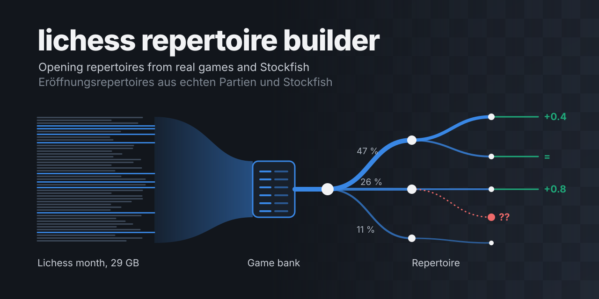

# lichess repertoire builder

**English** | [Deutsch](README.de.md)

Builds an opening repertoire from real Lichess games in your rating range. You name the opening, you get a PGN with:

- the moves your opponents actually play, one chapter per line, sorted by how often you meet it
- for each position, the mistakes your opponents make most often and what punishes them
- a Stockfish evaluation and a model game at the end of every line
- blue arrows for the setup that scored best in practice
- the typical pawn structures with all numbers

Different move orders that reach the same position are counted together. The games decide what goes in, Stockfish only checks. Open the PGN in a Lichess study or in ChessBase.

[Quick start](#quick-start-mac) · [What you get](#what-you-get) · [Options](#options) · [Good to know](#good-to-know)

## Quick start (Mac)

1. Install the programs once in the Terminal app. If Homebrew is missing, run the line from [brew.sh](https://brew.sh) first.

```bash
brew install python zstd pv mawk stockfish
```

2. Download the tool. Without git, use "Code" and "Download ZIP" on GitHub.

```bash
git clone https://github.com/MisterMiles/lichess-repertoire-builder.git
cd lichess-repertoire-builder
```

3. Build a repertoire.

```bash
bash repertoire.sh white "1. e4"
```

```bash
# Black against 1.d4 with 1...d5, opponents rated 1600 to 2000, quick trial run first
bash repertoire.sh black "1. d4 d5" --elo 1600-2000 --quick
```

For a full run use more months of games:

```bash
bash repertoire.sh white "1. e4" --months 3
```

## What you get

The files go to `repertoires` next to the tool folder (`--out` changes it).

| File | Content |
| --- | --- |
| `NAME.pgn` | The repertoire. Main lines run at least to move 15, rare lines are bundled at the end. |
| `NAME_quickstart.pgn` | The 15 most likely lines up to move 14, for practice. |
| `NAME_strukturen.json` | The typical pawn structures with all numbers. |

The PGN comments are in German. Games, engine cache and `konfiguration.json` stay in `repertoires/arbeit/NAME`. Read the quickstart file first, then use the main file as a reference. In a Lichess study, learn from the top: the order is the order of importance.

## Options

| Option | Meaning | Default |
| --- | --- | --- |
| `--elo FROM-TO` | Rating range of both players | 1800-2499 |
| `--month YYYY-MM` / `--month A..B` | One month or a range | last full month |
| `--months N` | The last N full months | off |
| `--data FOLDER` | Where the game bank (`bank/`, about 5 GB per month) and the resumable downloads (`download/`) live | `~/lichess-data` |
| `--keep-raw` | Keep the 29 GB monthly file after its bank table is built. Otherwise it is deleted once the table is verified, the bank stays | off |
| `--out FOLDER` | Where the finished files go | `repertoires` next to the tool |
| `--repertoire PGN` | Your own repertoire, its moves get marked | off |
| `--quick` | Trial run with low Stockfish depth | off |
| `--notation de` | German piece letters (S, L, T, D) in names and comments | English |
| `--plain` | No animation | animation on |

The full list is in the [full guide](docs/GUIDE.md). Settings for a single repertoire are in its `konfiguration.json`.

## Good to know

- Download: each Lichess month is about 29 GB and is downloaded once, with 4 connections, resumable. After an interruption, rerun the same command. Measured: 6 MB/s, about 1.5 to 2 hours per month. Yours may differ. `REPERTOIRE_VERBINDUNGEN=6` changes the number of connections.
- Game bank: every month becomes one compact table in `~/lichess-data/bank`, about 5 GB. It keeps the first 40 half moves of each game, without bullet and bot games. After that a search for your starting moves takes under a minute per month, for any opening, colour and rating range. For bullet, build a second bank: `bash gamebank.sh 2026-09 --data NEWFOLDER --keep-raw --with-bullet`.
- Stockfish needs 15 to 60 minutes. `--quick` shows a result within minutes. Wrong starting moves are caught before anything is downloaded.
- Long start moves: write them into a text file and use `bash repertoire.sh white @moves.txt`. Move numbers are optional, so `e4 c5 Nf3 e6` works as well.
- Running again with the same arguments computes only what is missing. A month already in the bank is never built again.
- The numbers are statistics of online games. Lines with few games are noisy, evaluations use a fixed depth, and the model game is an example, not a proof.
- Linux: instead of Homebrew use `sudo apt install python3-venv zstd pv mawk stockfish`, the rest is the same.

## License

GPL 3.0, see [LICENSE](LICENSE). Data: [Lichess open database](https://database.lichess.org), engine: [Stockfish](https://stockfishchess.org).
